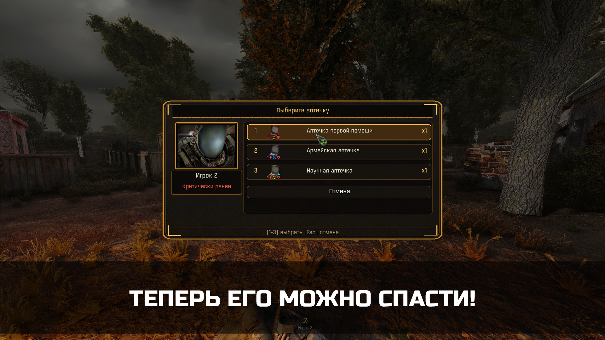
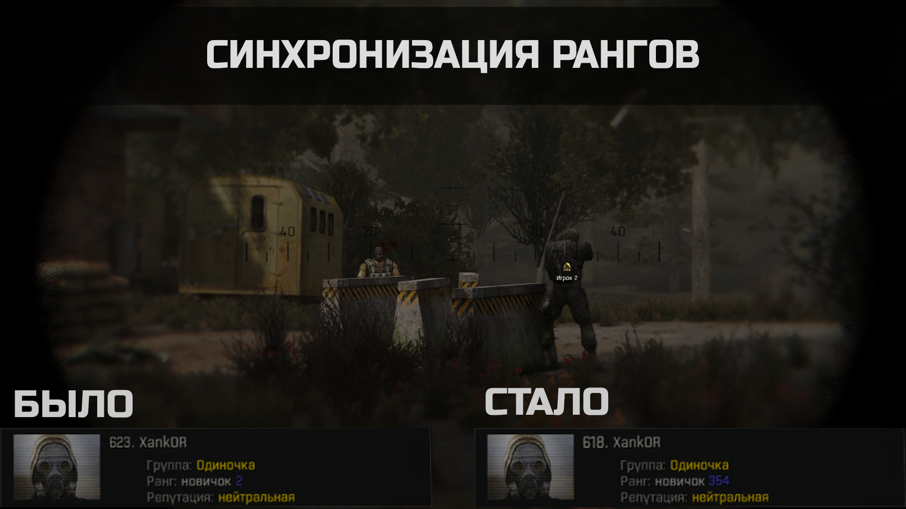
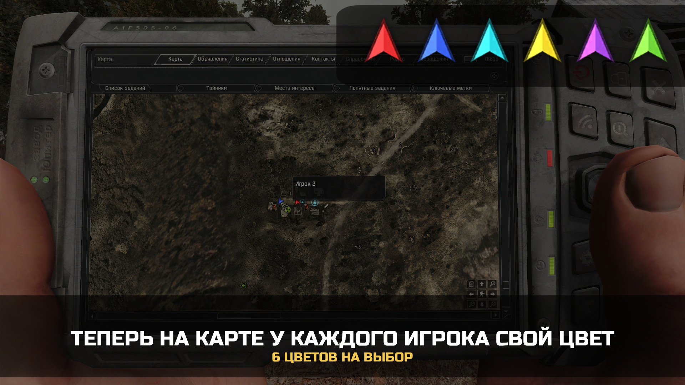
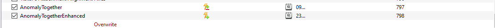

<!-- Баннер: положи изображение размером 1920×500 в папку screenshots и укажи его имя ниже. -->

# ☢️ ANOMALY TOGETHER ENHANCED

### Расширение возможностей совместной игры в S.T.A.L.K.E.R. Anomaly

**Больше возможностей. Больше взаимодействия. Больше совместных приключений в Зоне.**

---

## 📖 О проекте

**Anomaly Together Enhanced** — авторское расширение для оригинального мода **Anomaly Together** для **S.T.A.L.K.E.R. Anomaly**. Оно дополняет совместную игру новыми функциями, которые помогают участникам команды поддерживать друг друга, обмениваться ресурсами и удобнее ориентироваться на карте.

Модификация добавляет возможность поднимать товарищей из критического состояния, синхронизировать ранги игроков, передавать предметы и деньги, а также отображает маркеры игроков на карте выбранными ими цветами.

> **Важно:** Anomaly Together Enhanced работает исключительно с оригинальным Anomaly Together и не является самостоятельной заменой ему.

## ⚙️ Возможности

### 🩺 Поднятие товарища из критического состояния

Если напарник оказался в критическом состоянии, его можно поднять и помочь команде продолжить путь. Эта функция делает взаимовыручку важной частью совместного выживания в Зоне.

  
  

### 🎖️ Синхронизация рангов игроков

Модификация добавляет возможность синхронизировать ранги игроков, помогая согласовать прогресс участников совместной игры.

  

### 🎨 Цветные маркеры игроков на карте

Стрелка каждого игрока на карте отображается цветом, который он выбрал. Благодаря этому проще различать участников команды и ориентироваться во время совместных вылазок.

  

### 💰 Передача денег и 🎒 обмен предметами

Anomaly Together Enhanced позволяет передавать деньги и предметы другим игрокам. Делитесь необходимыми ресурсами, помогайте товарищам подготовиться к вылазке и распределяйте снаряжение внутри команды.

  
  

---

## 📦 Установка

### Требования

- **S.T.A.L.K.E.R. Anomaly**
- **Оригинальный Anomaly Together** — обязательная зависимость.

### Установка через Mod Organizer 2

1. Установите и настройте оригинальный **Anomaly Together**.
2. Установите **Anomaly Together Enhanced** как отдельный мод в Mod Organizer 2.
3. В левой панели Mod Organizer 2 разместите **Anomaly Together Enhanced ниже Anomaly Together**, чтобы у Enhanced был **более высокий приоритет перезаписи файлов**.
4. Убедитесь, что оба мода включены, затем запустите игру привычным способом.

  
   
  <em>Пример правильного порядка модов в Mod Organizer 2: Anomaly Together Enhanced расположен ниже Anomaly Together и имеет более высокий приоритет.</em>

> **Важно:** в Mod Organizer 2 моды, расположенные ниже в левой панели, имеют приоритет при перезаписи конфликтующих файлов. Поэтому **Anomaly Together Enhanced должен находиться ниже Anomaly Together**.

---

## 🔗 Оригинальный Anomaly Together

Anomaly Together Enhanced предназначен **исключительно для работы с оригинальным Anomaly Together**.

[**Discord-сообщество Anomaly Together**](https://discord.com/invite/mp-together)

Совместимость с другими модификациями, изменяющими те же игровые механики или элементы интерфейса, не гарантируется и может зависеть от используемых версий.

---

## 📝 Примечание

**P.S.** Аддон тестировался на сборке **S.T.A.L.K.E.R. Anomaly G.A.M.M.A.** Это не гарантирует совместимость со всеми версиями игры, сборками или наборами модификаций.

---

### ☢️ Увидимся в Зоне, сталкер.

**ANOMALY TOGETHER ENHANCED**  

*An extension by XankOR*

