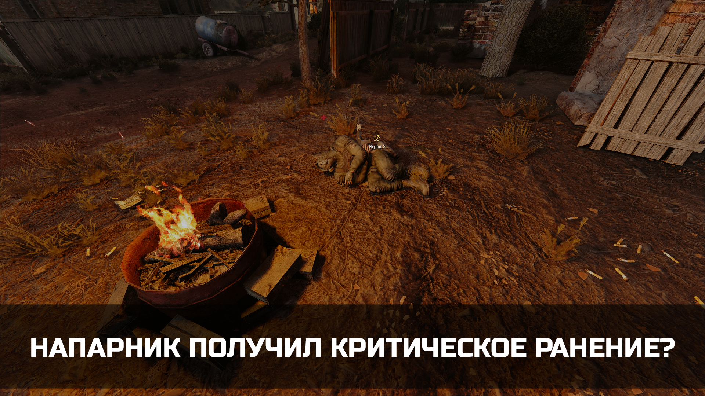
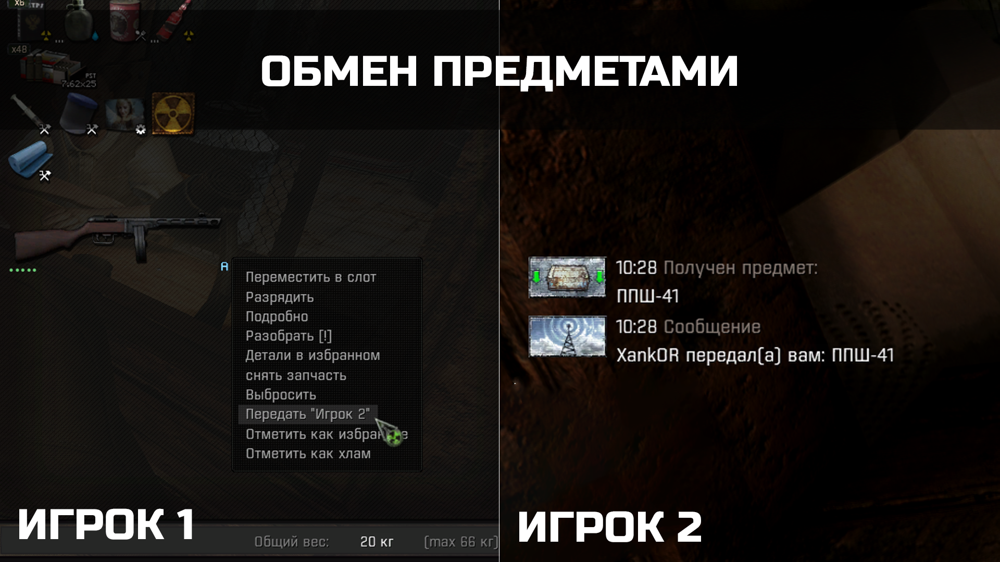
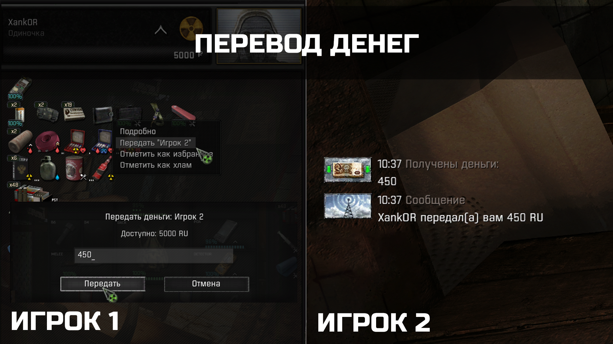

# ☢️ ANOMALY TOGETHER ENHANCED

### Расширение возможностей совместной игры в S.T.A.L.K.E.R. Anomaly

**Больше возможностей. Больше взаимодействия. Больше совместных приключений в Зоне.**

---

## 📖 О проекте

**Anomaly Together Enhanced** — авторское расширение для оригинального мода **Anomaly Together** для **S.T.A.L.K.E.R. Anomaly**. Оно дополняет совместную игру новыми функциями, которые помогают участникам команды поддерживать друг друга, обмениваться ресурсами и удобнее ориентироваться на карте.

Модификация добавляет возможность поднимать товарищей из критического состояния, синхронизировать ранги игроков, передавать предметы и деньги, а также отображает маркеры игроков на карте выбранными ими цветами.

> **Важно:** Anomaly Together Enhanced работает исключительно с оригинальным Anomaly Together и не является самостоятельной заменой ему.

## ⚙️ Возможности

### 🩺 Поднятие товарища из критического состояния

Если напарник оказался в критическом состоянии, его можно поднять и помочь команде продолжить путь. Эта функция делает взаимовыручку важной частью совместного выживания в Зоне.

  
  

### 🎖️ Синхронизация рангов игроков

Модификация добавляет возможность синхронизировать ранги игроков, помогая согласовать прогресс участников совместной игры.

  

### 🎨 Цветные маркеры игроков на карте

Стрелка каждого игрока на карте отображается цветом, который он выбрал. Благодаря этому проще различать участников команды и ориентироваться во время совместных вылазок.

  

### 💰 Передача денег и 🎒 обмен предметами

Anomaly Together Enhanced позволяет передавать деньги и предметы другим игрокам. Делитесь необходимыми ресурсами, помогайте товарищам подготовиться к вылазке и распределяйте снаряжение внутри команды.

  
  

---

## 📦 Установка

### Требования

- **S.T.A.L.K.E.R. Anomaly**
- **Оригинальный Anomaly Together** — обязательная зависимость.

### Установка

1. Установите и настройте оригинальный Anomaly Together.
2. Скачайте файлы Anomaly Together Enhanced из репозитория.
3. Установите модификацию способом, указанным в инструкциях к её релизу.
4. Убедитесь, что версии основного мода и расширения совместимы.

*Подробные инструкции по установке и дополнительные требования можно добавить сюда по мере подготовки релиза.*

## 🔗 Оригинальный Anomaly Together

Anomaly Together Enhanced предназначен **исключительно для работы с оригинальным Anomaly Together**.

[**Discord-сообщество Anomaly Together**](https://discord.com/invite/mp-together)

Совместимость с другими модификациями, изменяющими те же игровые механики или элементы интерфейса, не гарантируется и может зависеть от используемых версий.

## 👤 Авторство

**Автор расширения: XankOR**

Anomaly Together Enhanced — авторская модификация, расширяющая функциональность оригинального Anomaly Together. Оригинальный Anomaly Together является отдельным проектом и не принадлежит автору этого расширения, если иное не указано его правообладателями.

Права на S.T.A.L.K.E.R., оригинальный Anomaly Together и другие сторонние материалы принадлежат соответствующим правообладателям.

---

### ☢️ Увидимся в Зоне, сталкер.

**ANOMALY TOGETHER ENHANCED**  
*An extension by XankOR*

